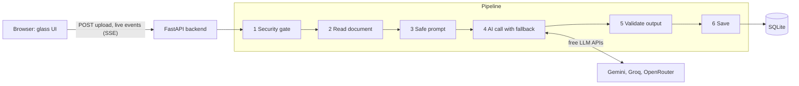

# DocLens

DocLens reads invoices and receipts and returns clean, checked, structured data, and it shows every step of the work live while it happens.


## What it does

1. You upload a PDF or a photo of an invoice or receipt.
2. A live pipeline runs six stages and shows each one in the browser as it works.
3. You get vendor, invoice number, date, currency, line items, subtotal, tax, and total as JSON.
4. Automatic checks (shape, dates, and maths) decide whether the result is trustworthy or needs a human look.
5. You can correct any field, and the corrected version is saved next to the AI's original answer.

## Architecture



| Stage | What happens |
|---|---|
| Security gate | Checks the file name, type, size, and real content (magic bytes) |
| Read document | Extracts text from PDFs, or turns scans and photos into clean, small images |
| Safe prompt | Keeps our rules apart from the document, wraps it in one-time random markers, and scans for injection phrases |
| AI call | Tries providers in order and falls back if one fails or hits its free limit |
| Validate output | Parses the JSON, checks the schema, the line maths, the totals, and the dates, then sets `ok` or `needs_review` |
| Save | Stores the result (never the uploaded file) in SQLite |

## Security

- **Upload checks:** extension allow-list, size limit, magic-byte check, filename sanitization, and early rejection of oversized requests.
- **Prompt injection defence in layers:** separate system and user parts, a random boundary per request, an injection phrase scanner, an AI with no tools or data access, and strict output validation.
- **Output is untrusted:** every AI answer is parsed, cleaned, and validated before it is shown or stored.
- **Web security:** strict Content Security Policy, no inline scripts, and all dynamic text is inserted with `textContent` (no `innerHTML`).
- **Database:** parameterized queries only, random unguessable IDs, no uploaded files or document text stored, and automatic deletion after 30 days.
- **Abuse protection:** per-visitor rate limit, a global daily limit, and a cap on how many documents are processed at once.
- **Secrets:** API keys live only in environment variables and are never sent to the browser.

## Evaluation

I measured accuracy on **10 synthetic documents** with known correct answers, generated by `evaluation/make_samples.py`. The set includes text PDFs in USD, INR, and EUR number formats, a photo-like PNG, a scanned PDF, an invoice with 8 line items, a receipt with no invoice number, and two prompt injection documents (one with hidden white text).

| Result (Groq, November 2026, n = 10 documents) | |
|---|---|
| Field accuracy on answered documents | 100% |
| Documents flagged `needs_review` by the validation layer | 3 |
| Average time per document | 1.88 s |

Only Groq has been evaluated so far. The harness can compare providers with `--providers gemini,groq`, and every run saves a full JSON report in `evaluation/results/`.

**Read these numbers carefully.** Ten synthetic documents are a small and fairly clean test set, so real-world accuracy will be lower. Free models also change over time, so results are tied to the date and model of the run.

## Tech stack

Python, FastAPI, Pydantic, httpx, pypdfium2, Pillow, SQLite, Server-Sent Events, and plain HTML, CSS, and JavaScript (no frontend framework or build step). Docker and Render for deployment.

## Run it locally

```bash
cd backend
python3 -m venv venv
source venv/bin/activate
pip install -r requirements.txt
cp .env.example .env        # then add at least one free API key
uvicorn app.main:app --reload
```

Open http://127.0.0.1:8000 in your browser.

Run the evaluation:

```bash
pip install -r ../evaluation/requirements-dev.txt
python ../evaluation/make_samples.py
python ../evaluation/run_eval.py
```

Run with Docker:

```bash
docker build -t doclens .
docker run --env-file backend/.env -p 8000:8000 doclens
```

## Configuration

Every setting is an environment variable. See [`backend/.env.example`](backend/.env.example) for the full list, including provider keys, models, upload limits, and rate limits.

## API

| Method | Route | Purpose |
|---|---|---|
| GET | `/api/health` | Health check |
| GET | `/api/config`, `/api/providers` | Public limits and provider status (no keys) |
| POST | `/api/upload` | Run the pipeline and return the final result |
| POST | `/api/upload/stream` | Run the pipeline and stream live stage events (SSE) |
| GET | `/api/documents`, `/api/documents/{id}` | History and one saved result |
| PATCH | `/api/documents/{id}` | Save human corrections and re-run the checks |
| DELETE | `/api/documents/{id}` | Delete a record |
| GET | `/api/stats` | Summary numbers |

Interactive API docs are available at `/docs`.

## Project structure

```
doclens/
├── backend/
│   ├── app/
│   │   ├── security/    sanitizer, file validator, prompt guard, rate limiter
│   │   ├── services/    reader, prompt builder, AI providers, validation, pipeline, SSE
│   │   ├── db/          SQLite setup and queries
│   │   ├── config.py
│   │   └── main.py
│   ├── requirements.txt
│   └── .env.example
├── frontend/            index.html, css, js
├── evaluation/          sample generator, metrics, runner
├── Dockerfile
└── render.yaml
```

## Design decisions

- **SSE instead of WebSockets:** the browser only needs updates from the server, and SSE works over normal HTTP.
- **A provider layer with fallback:** free tiers have limits and change, so no single provider is a dependency.
- **The AI gets no tools:** the worst a tricked model can do is return a wrong answer, which validation then checks.
- **Human in the loop:** uncertain results are flagged, and corrections are stored separately so accuracy can be measured later.
- **No uploaded files stored:** less risk, and nothing sensitive to leak.
- **SQLite with JSON columns:** simple and enough for a demo, easy to replace with PostgreSQL.

## Limitations

- No user accounts, so history is shared by everyone who can open the app.
- Rate limits are kept in memory and work with a single worker.
- On Render's free tier, the app sleeps when idle and the database file is reset on restart.
- Free AI services may keep or learn from submitted data, so use sample documents only.
- Handwriting, complex tables, and multi-page documents beyond a few pages are not supported.
- The evaluation set is small and synthetic.

## Roadmap

User accounts, PostgreSQL, a queue for long documents, more document types, and a larger held-out evaluation set with real-style documents.